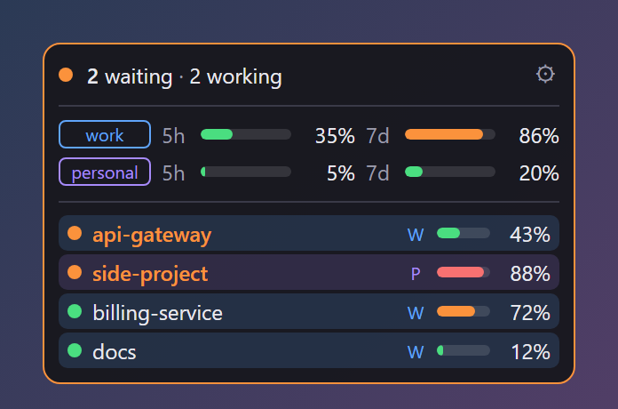
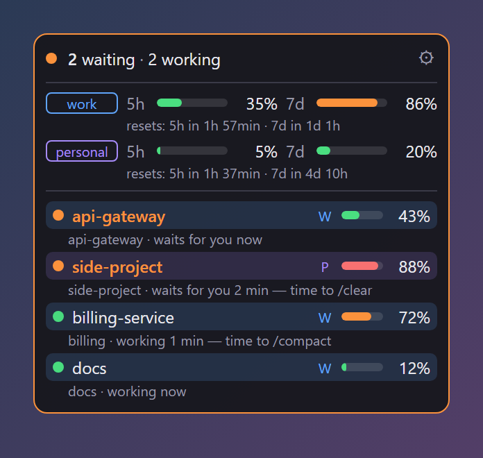
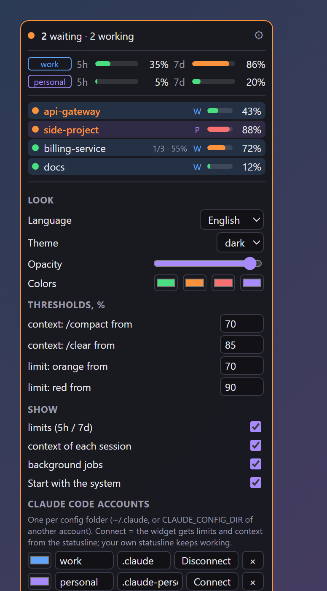
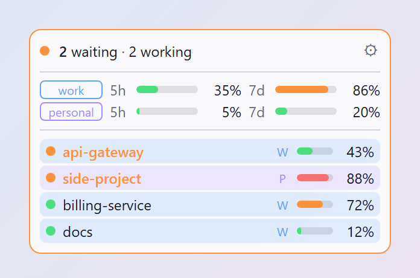

# cc-widget

A tiny always-on-top desktop widget for [Claude Code](https://claude.com/claude-code). It shows at a glance:

- **which sessions are waiting for your answer**, and which are still working;
- **how full each session's context is**, so you know when to `/compact` or `/clear`;
- **how much of the 5-hour and 7-day limits** each of your accounts has used, and when they reset.

Windows, macOS and Linux. Free and open source (MIT).

<p align="center">
  
</p>

## Why

When you run Claude Code in several terminals (or under two accounts) you keep switching windows to see whether
anything is done. cc-widget sits in a corner of the screen and turns orange when a session finishes its turn and
waits for you. **Click a session** to mark it as seen and bring up the terminal or IDE window it runs in.
Drag the widget anywhere and **resize it** by its edge: the width and the layout you drag to are kept (full, compact,
session chips, status dots — no scrolling) and the height follows the sessions as they come and go. Click
the header for the details.

| Details (click the header) | Settings (⚙) | Light theme |
|---|---|---|
|  |  |  |

## Install

Download the installer for your system from [Releases](https://github.com/theone55/cc-widget/releases/latest):

| System | File |
|---|---|
| Windows | `cc-widget_x.y.z_x64-setup.exe` |
| macOS (Apple Silicon and Intel) | `cc-widget_x.y.z_universal.dmg` |
| Linux | `.AppImage`, `.deb` or `.rpm` |

The builds are not code-signed yet:

- **Windows:** SmartScreen may say "Windows protected your PC" → *More info* → *Run anyway*.
- **macOS:** if it says the app is damaged, run `xattr -cr /Applications/cc-widget.app` once.

## Setup

1. Start cc-widget. It finds your Claude Code config folders (`~/.claude`, and `~/.claude-*` for more accounts).
2. Open ⚙ and press **Connect** next to each account. This is what gives the widget **limits and context**.

The session list works right away. Limits and context come from Claude Code's statusline: Claude Code hands them only
to the statusline command. **Connect** puts cc-widget in front of your statusline. It saves the numbers, then runs your
previous statusline with the same input, so your terminal looks exactly as before (if you had none, you get a short one:
`ctx 34% │ 5h 12% │ 7d 40%`). **Disconnect** puts the previous one back. A backup of your `settings.json` is kept next
to it as `settings.json.cc-widget-backup`.

If you already have a statusline script, you can instead have it write the numbers itself. cc-widget reads:

- `<config dir>/widget-limits.json` = `{"five_hour": …, "seven_day": …}`, which is `rate_limits` from the statusline input;
- `<temp dir>/claude-ctx-<session_id>.json` = `{"used_pct": 42}`.

## Settings

Everything is in ⚙:

- **Look:** theme (system / dark / light), language (English, Russian), opacity, and the four colors.
- **Thresholds:** when the context turns orange (`/compact`) or red (`/clear`), and the same for limits.
- **What to show:** limits, context, background jobs.
- **Start with the system.**
- **Accounts:** a label and a config folder each (several accounts via `CLAUDE_CONFIG_DIR`).
- **Counter (optional):** a few numbers from your own server in the header, for example a site's visitors.
- **System (optional, off by default):** CPU load with a tile per core, memory, an NVIDIA card's load and
  temperature (through `nvidia-smi`), the CPU temperature where the system reports it, and a 2-minute graph in the details.
  cc-widget sends `GET <url>`, gets JSON back and reads the fields you list as dot paths, optionally named (`today=visitors.today`). An optional
  token is kept in the system keychain; it is fetched every N minutes (5 by default). With a *pass URL*, the token is
  first swapped there for a short-lived pass, reused for 50 minutes
  (`{"pass": "…"}`).

Settings are kept in `settings.json` in the app's config folder:

- Windows: `%APPDATA%\io.github.theone55.cc-widget`
- macOS: `~/Library/Application Support/io.github.theone55.cc-widget`
- Linux: `~/.config/io.github.theone55.cc-widget`

## How it works, and what it does not do

- The session list is read from `~/.claude*/sessions/*.json`. Claude Code keeps one file per running session there,
  with its status (`busy` / `idle`). This is Claude Code's **internal** format, not a public API. If an update changes
  it, the list goes empty until cc-widget is updated. Nothing else breaks.
- cc-widget reads local files only. The one network call is the optional counter, to the address you enter.
- Bringing up a session's window: Windows finds the window of the terminal / IDE above the session's process; macOS
  asks System Events to bring that app to the front (macOS may ask for permission once); Linux uses `xdotool` or
  `wmctrl` if installed (X11; Wayland doesn't allow it).
- It never sends, reads or changes your conversations. The only file it writes outside its own folder is the
  statusline setting, and only when you press **Connect**.

## Build from source

You need Node 22, Rust (stable) and the [Tauri prerequisites](https://tauri.app/start/prerequisites/) for your system.

```sh
npm install
npm run dev        # run with hot reload of ui/
npm run build      # installers in src-tauri/target/release/bundle/
cd src-tauri && cargo test
npm run shots      # the README screenshots (headless Chrome, demo data)
```

The UI is plain HTML/CSS/JS in `ui/` (no bundler). The Rust side in `src-tauri/src/` covers sessions, limits, settings,
the statusline wrapper and the counter.

## License

MIT
